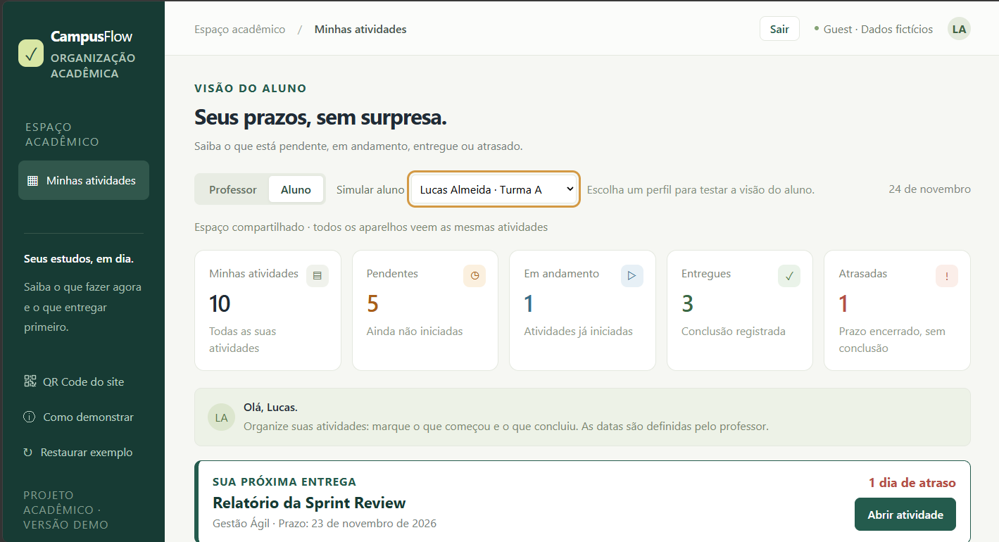
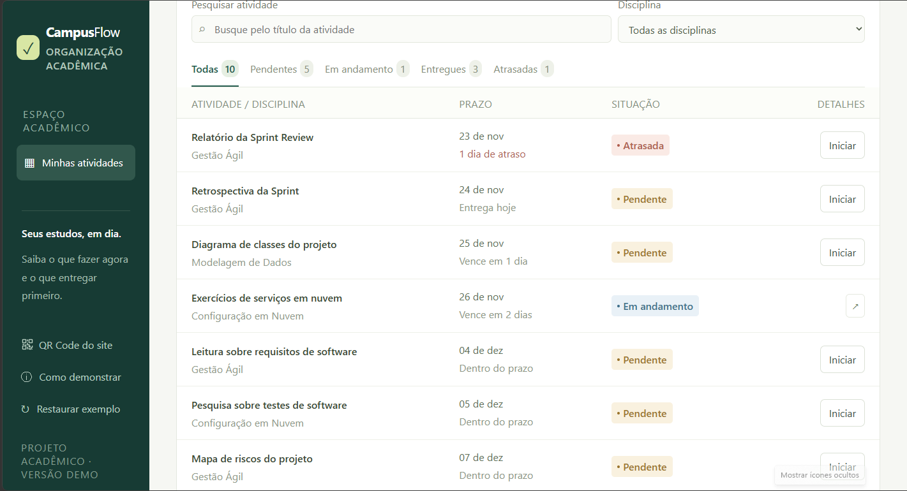
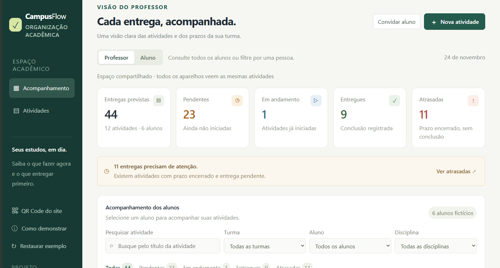
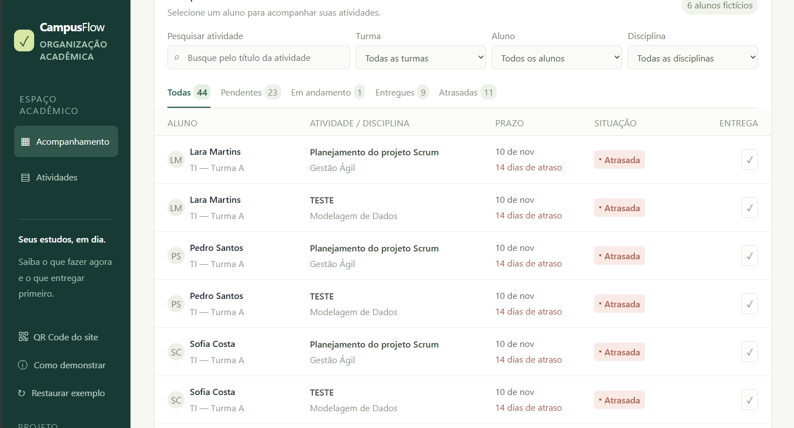

# 🎓 CampusFlow — Organização Acadêmica

### Seus estudos, em dia.

O **CampusFlow** é uma plataforma acadêmica desenvolvida em equipe com o objetivo de facilitar a organização, o gerenciamento e o acompanhamento de atividades entre professores e alunos.

O sistema permite visualizar prazos, acompanhar o andamento das atividades e identificar entregas pendentes ou atrasadas.

## 🌐 Acesse o projeto

🔗 **[Clique aqui para testar o CampusFlow](https://campusflow-demo.campusflow-app.workers.dev/)**

> Versão demonstrativa com dados fictícios para apresentação e testes.

---

## 🚀 Funcionalidades

### 👨‍🎓 Visão do aluno
- Visualização das atividades cadastradas.
- Acompanhamento de prazos.
- Identificação de atividades pendentes, em andamento, entregues e atrasadas.
- Registro do início e da conclusão de atividades.
- Filtros para facilitar a organização.

### 👨‍🏫 Visão do professor
- Cadastro de atividades com prazos.
- Acompanhamento das entregas dos alunos.
- Consulta por aluno, turma e disciplina.
- Identificação de atividades atrasadas.
- Visualização geral do andamento da turma.

---

## 📸 Demonstração do sistema

### 1. Painel do aluno

### 2. Atividades do aluno

### 3. Painel do professor

### 4. Acompanhamento dos alunos

---

## 🎥 Vídeo demonstrativo

https://github.com/user-attachments/assets/821650cb-7791-44c9-abd6-919dfee5a481

---

## 📋 Metodologia de desenvolvimento

O projeto foi desenvolvido em equipe, utilizando práticas da metodologia ágil Scrum.

O trabalho foi organizado em **4 Sprints**, com planejamento, desenvolvimento, testes e melhorias ao longo do projeto.

Os integrantes participaram da organização das atividades, dos testes e das sugestões de melhorias.

---

## 👥 Desenvolvimento em equipe

O CampusFlow foi desenvolvido como projeto acadêmico por um grupo de seis integrantes.

**Minha contribuição:** desenvolvimento do site, implementação de funcionalidades e realização de ajustes a partir dos testes e feedbacks dos colegas.

O grupo também participou do planejamento, da validação e da apresentação do projeto.

---

## 🛠️ Tecnologias e ferramentas

- Cloudflare Workers — publicação da aplicação.
- GitHub — documentação do projeto.
- Scrum — organização do desenvolvimento.

---

## 🎯 Objetivo do projeto

Oferecer uma maneira mais organizada de acompanhar atividades acadêmicas, facilitando a comunicação dos prazos e a visualização do progresso dos alunos.

---

**CampusFlow — Organização Acadêmica**

Projeto desenvolvido para fins educacionais.
